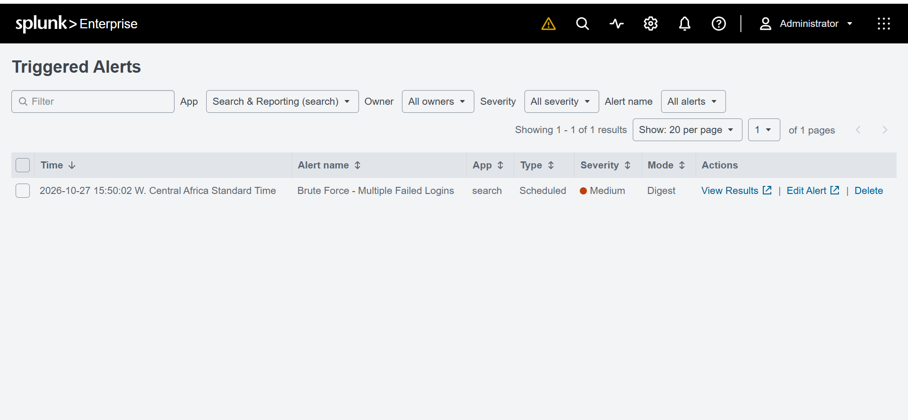
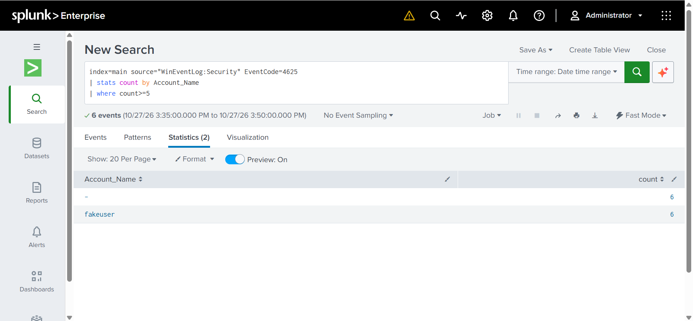
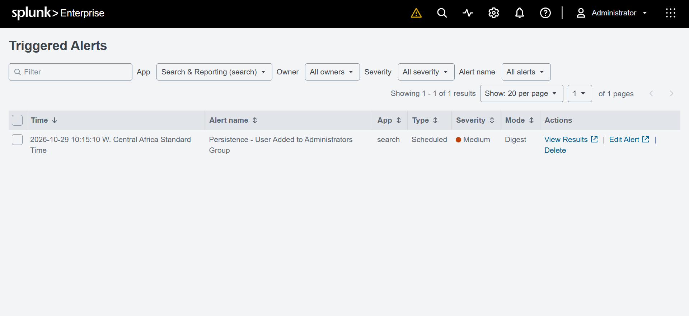
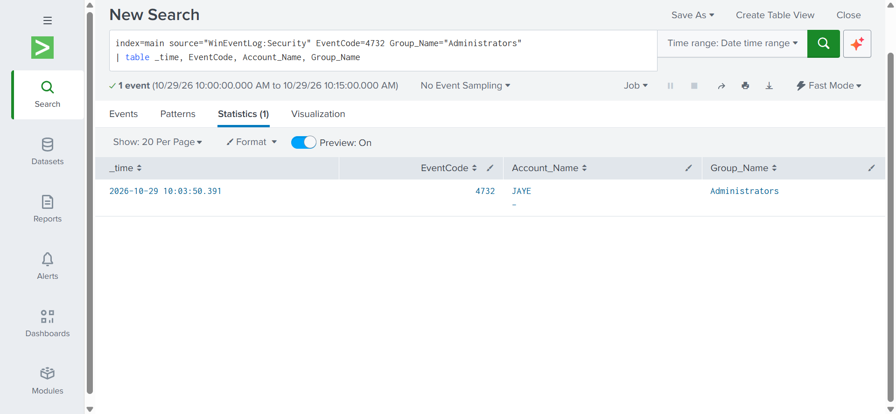
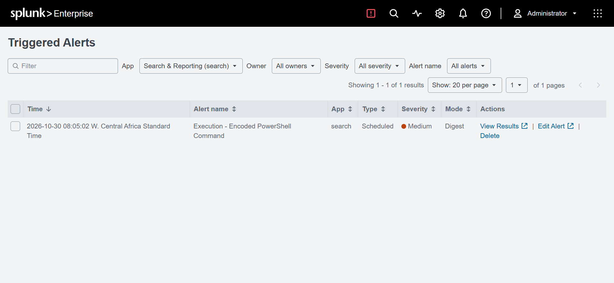
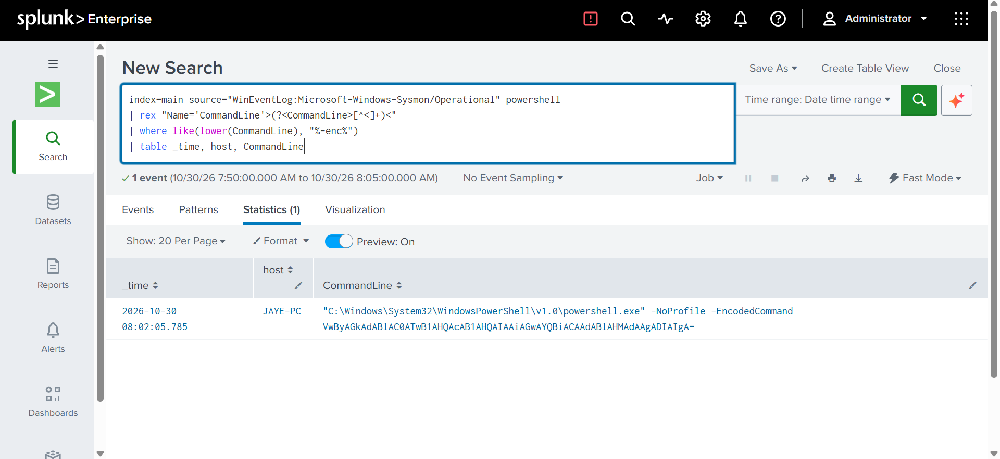

# Splunk SIEM Detection Lab

A home SOC lab where I build and test detection rules in Splunk, mapped to the MITRE ATT&CK framework.

## Lab setup
- **SIEM:** Splunk Enterprise (local install on Windows)
- **Endpoint telemetry:** Windows Security, System and Application event logs, plus Sysmon
- **Approach:** generate safe test activity on my own machine, confirm the logs appear in Splunk, write a detection, then confirm the alert fires

## Detections

| Detection | MITRE ATT&CK | Log source | Status |
|-----------|--------------|------------|--------|
| [Brute Force - Multiple Failed Logins](Detections/brute-force-4625.md) | T1110 | Windows Security (Event ID 4625) | Done |
| [Persistence - User Added to Administrators Group](Detections/admin-group-4732.md) | T1136 | Windows Security (Event ID 4732) | Done |
| [Execution - Encoded PowerShell Command](Detections/encoded-powershell-sysmon1.md) | T1059.001 | Sysmon (Event ID 1) | Done |

## Evidence: brute force detection firing

## Evidence: admin group detection firing

## Evidence: encoded PowerShell detection firing

## What I learned
- How to get Windows event logs and Sysmon data into Splunk
- How to write SPL searches that count and filter events
- How to turn a search into a scheduled alert and test that it works
- Why alert tuning matters (thresholds, time windows, allowlists)
- How to filter out noisy events (only alerting on the Administrators group, not every group change)
- How to troubleshoot an alert that wasn't firing, using Splunk's scheduler logs (`index=_internal sourcetype=scheduler`)
- Why Splunk can stop running searches when disk space runs low, and how to fix it
- Why overlapping schedule and time windows cause duplicate alerts, and how throttling prevents them

